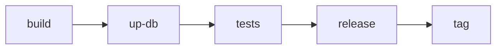

# taskflow

[](https://pkg.go.dev/github.com/aptd3v/containerkit/pkg/taskflow)

Optional DAG runner for containerkit. It orders the same `*kit.Container`, `kit.Build`, and `*kit.Compose` values you already have, plus ordinary Go functions.

`pkg/kit` and `pkg/client` do not import this package. A program that never imports `taskflow` never downloads [go-taskflow](https://github.com/noneback/go-taskflow).

```
go get github.com/aptd3v/containerkit
```

```go
import "github.com/aptd3v/containerkit/pkg/taskflow"
```

## Contents

- [When to use it](#when-to-use-it)
- [Quick start](#quick-start)
- [Mental model](#mental-model)
- [Steps](#steps)
- [Edges](#edges)
- [Failure, Always, Retry](#failure-always-retry)
- [If and Condition](#if-and-condition)
- [Subflow](#subflow)
- [Run](#run)
- [Dump, Profile, Trace](#dump-profile-trace)
- [Labels, List, Remove](#labels-list-remove)
- [Errors](#errors)
- [Worked CI graph](#worked-ci-graph)
- [API](#api)

## When to use it

Use taskflow when `main` would otherwise be a sequence of `Build` / `Up` / `ContainerCreate` / `Down` calls and you want:

- independent steps to run in parallel
- a failed step to skip its dependents without aborting siblings
- teardown that still runs after a failure (`Remove`, or `Always`)
- a branch (`If`) or a retry cycle (`Condition`)
- a DOT dump, a flamegraph, or a Chrome trace of the graph

Stay in `kit.NewCompose` / `client` when the work is one stack or one container. Taskflow does not replace Compose `DependsOn`; it orders *your* calls.

## Quick start

```go
flow := taskflow.New("ci", cli)
build := flow.Build("build",
	kit.NewBuild().Dockerfile(df),
	&client.ImageBuild{Tags: []string{"app:ci"}},
)
up := flow.Compose("up-db", db, &kit.Up{Detach: true, Wait: true})
test := flow.Container("test", kit.NewContainer().Image("app:ci"), nil)

test.DependsOn(up.DependsOn(build))

defer flow.Remove(ctx)
err := flow.Run(ctx, &taskflow.Run{Writer: os.Stdout})
```

`cli` may be `nil` when every step is `Task` or Compose. `Container` and `Build` need a client.

Runnable demo: [`examples/taskflow`](../../examples/taskflow).

## Mental model



A `Flow` is a named graph. You add steps, then wire edges, then call `Run` once. Independent steps with all predecessors done run concurrently.

| Piece | Role |
|---|---|
| `Flow` | The graph. One `Run` per value. |
| `Task` | One node. Every constructor returns `*Task`. |
| `Subflow` | Nested graph with the same constructors as `Flow`. |
| `Precede` / `DependsOn` | Edge. `a.Precede(b)` is `b.DependsOn(a)`: A then B. |
| `Run` | Options for `Flow.Run`. Nil means defaults. |

## Steps

`Flow` and `Subflow` share these constructors.

| Constructor | Runs |
|---|---|
| `Task(name, fn)` | `fn(ctx) error` |
| `Build(name, kit.Build, *client.ImageBuild)` | `client.ImageBuild` |
| `Container(name, *kit.Container, *ContainerRun)` | remove by name → create → start → wait-for-exit |
| `Compose(name, *kit.Compose, cmd)` | `*kit.Up` / `*kit.Logs` / … or `fn(ctx, app)` |
| `Subflow(name, instantiate)` | nested graph; `instantiate` runs once when the subflow starts |
| `If(name, pred)` | boolean branch (`Then` / `Else`) |
| `Condition(name, pred)` | indexed branch (`Precede` order) |

### Container

One-shot. A non-zero exit fails the step. `RestartAlways` / `UnlessStopped` / `OnFailure` and `AutoRemove` are rejected: this step records the first exit, then copies logs. Long-running services belong in `Compose` with `*kit.Up`; flaky jobs use `Retry`.

The step writes to the `*kit.Container` you pass: it sets `Name` when empty and adds the `containerkit.*` labels. Do not reuse that value as if it were untouched.

```go
unit := flow.Container("unit",
	kit.NewContainer().Image("app:ci").Command("go", "test", "./..."),
	nil,
)
```

`ContainerRun.Logs` is a per-step override. Nil means `Run.Writer`. `io.Discard` silences one step.

### Build

```go
flow.Build("build", kit.NewBuild().Dockerfile(df), &client.ImageBuild{
	Tags: []string{"app:ci"},
})
```

Output goes to `Run.Writer`, with a tee into `Run.Log` when set.

### Compose

`cmd` is a `*kit` option. The struct is copied so the caller's value is not mutated. A nil `Writer` on the option means `Run.Writer`.

```go
up := flow.Compose("up-db", db, &kit.Up{Detach: true, Wait: true})
logs := flow.Compose("logs", db, &kit.Logs{Follow: true, ServiceNames: []string{"db"}})
```

Use a func for `Events`, `LoadProject`, or options that depend on earlier steps:

```go
flow.Compose("events", db, func(ctx context.Context, app *kit.Compose) error {
	ev, errs, err := app.Events(ctx, &kit.EventsOpt{})
	_ = ev
	_ = errs
	return err
})
```

Prefer `defer flow.Remove` for end-of-run teardown so `List` can still see the stack. Use a `*kit.Down` step when the graph itself must bring the project down (and `Always` if that must happen after a failure).

## Edges

```go
build.Precede(up)     // build, then up
up.DependsOn(build)   // same edge
test.DependsOn(up.DependsOn(build))
```

`Precede` on an `If` is `Then`. On a `Condition`, argument order is the branch index (`0`, `1`, …).

`Priority` only orders the scheduler queue among ready steps. It does not override edges.

```go
flow.Container("lint", lint, nil).Priority(taskflow.PriorityLow)
```

`PriorityHigh`, `PriorityNormal`, `PriorityLow`. Zero is ignored.

## Failure, Always, Retry

A failed or skipped step skips its successors. Siblings keep running. `Run` joins every step error and returns after the graph drains.

```
check ──► publish     // check fails → publish skipped
bundle ──► publish    // bundle still runs; publish still skipped
```

`Always` runs a step even when a predecessor failed or was skipped. The upstream failure still propagates: successors of the `Always` step are skipped as if it had failed. Use it for teardown that must live *in* the graph.

```go
down := flow.Compose("down-db", db, &kit.Down{RemoveVolumes: true}).Always()
```

`Retry(n)` reruns a failing step up to `n` more times. Each failed attempt emits `EventRetry` with `Attempt` (1-based) and `Err`. Panics and a canceled context are not retried.

```go
flow.Container("integration", integ, nil).Retry(2) // up to 3 attempts
```

For end-of-run Compose teardown, `defer flow.Remove` is enough. `Always` is for a step that must run *before* later graph nodes see the result (or when you need Down in the middle of the DAG).

## If and Condition

### If

Boolean branch. `Then` is true, `Else` is false. A missing side is a no-op. If a predecessor failed, the `If` is **skipped** and neither branch runs.

```go
release := flow.If("release", func(context.Context) bool {
	return os.Getenv("RELEASE") == "1"
})
release.Then(tag)
release.Else(skip) // optional
```

That is the usual “only tag a green run” gate.

### Condition

Indexed branch. The function returns a `uint`; that number selects the successor in `Precede` order.

```go
gate := flow.Condition("gate", func(context.Context) uint {
	if ok {
		return 0
	}
	return 1
})
gate.Precede(ship, retry) // 0 = ship, 1 = retry
```

Unlike `If`, a `Condition` **still runs after a failed predecessor**. That is required for a retry cycle: a non-condition node is the first entry, and the `Condition` sits on the back edge.

```go
start.Precede(body)
body.Precede(verify)
verify.Precede(done, body) // 0 = leave, 1 = run body again
```

An out-of-range index, or a `Condition` with no successors, fails the step instead of panicking. Nothing after it runs.

| | `If` | `Condition` |
|---|---|---|
| Predicate | `bool` | `uint` index |
| Edges | `Then` / `Else` | `Precede` order |
| Missing branch | no-op | error |
| Upstream failed | skipped | still runs |

For retrying one step, `Retry(n)` is simpler than a `Condition` loop.

## Subflow

A nested graph. Inner constructors match `Flow`. `instantiate` runs once, when the subflow starts.

```go
tests := flow.Subflow("tests", func(sf *taskflow.Subflow) {
	sf.Container("unit", unit, nil).Priority(taskflow.PriorityHigh)
	sf.Container("integration", integ, nil).Retry(2)
	sf.Container("lint", lint, nil).Priority(taskflow.PriorityLow)
})
```

Independent inner steps run in parallel. If any inner step fails, the subflow counts as failed: successors of `tests` are skipped. `Subflow.Err()` is only the subflow node's own error (usually nil); inner errors are on those tasks and in the error `Run` returns.

Step names are not unique across subflows. Compare `Event.Task`, not `Event.Name`.

`Run.Concurrency` defaults to `GOMAXPROCS` and is raised above the number of known subflows (go-taskflow needs a spare worker to enter a nested graph).

## Run

```go
err := flow.Run(ctx, &taskflow.Run{
	Writer:      os.Stdout, // default
	Concurrency: 0,         // GOMAXPROCS, then ≥ subflows+1
	Profile:     os.Stdout, // flamegraph text when the graph finishes
	Trace:       traceFile, // Chrome Trace JSON
	Watch:       func(e taskflow.Event) { fmt.Println(e.Kind, e.Name) },
	Log:         func(step string, p []byte) { /* partial writes */ },
})
```

Nil `*Run` is defaults. `Run` is not reusable: a second call returns `ErrAlreadyRun`.

| Field | Meaning |
|---|---|
| `Writer` | Build output, container logs, Compose output. Nil → `os.Stdout`. |
| `Watch` | Step lifecycle. May run on several worker goroutines. |
| `Log` | Step-scoped bytes (build stream, container logs, compose output). Partial writes. Concurrent. |
| `Profile` | Flamegraph text after the graph finishes. Nil disables. |
| `Trace` | Chrome Trace JSON after the graph finishes. Nil disables. |
| `Concurrency` | Worker count. |

### Watch

```go
func watch(e taskflow.Event) {
	switch e.Kind {
	case taskflow.EventStart:
	case taskflow.EventDone:
	case taskflow.EventSkip:
	case taskflow.EventRetry:
		fmt.Printf("[%s] attempt %d failed: %v\n", e.Name, e.Attempt, e.Err)
	case taskflow.EventError:
		fmt.Printf("[%s] %v\n", e.Name, e.Err)
	}
}
```

`Event.Task` is the step. `Event.Err` is set for `EventError` and `EventRetry`. `Event.Attempt` is set for `EventRetry`. `Event.Duration` is set for finished attempts.

This is the scheduler timeline, not OpenTelemetry. Engine HTTP spans are a client option (`client.WithTraceProvider`) and nest under whatever span is already on `ctx`. Taskflow does not start an OTel span per step.

## Dump, Profile, Trace

```go
_ = flow.Dump(os.Stdout) // DOT, available before Run
```

`Dump` is the static graph. `Run.Profile` is go-taskflow flamegraph text. `Run.Trace` is [Chrome Trace](https://ui.perfetto.dev) JSON (`chrome://tracing` also works). Each event is a complete span (`ph: "X"`) with name, category (`static` / `subflow` / `condition`), start, duration, and optional `parent` / `dependents`.

## Labels, List, Remove

At `Run`, Container and Compose steps stamp:

| Label | Value |
|---|---|
| `containerkit.flow` | `Flow.Name()` |
| `containerkit.task` | step name (`up-db` for Compose, first Compose step wins) |
| `containerkit.depends` | nearest predecessor *container* names (Container steps) |
| `containerkit.precedes` | nearest successor *container* names (Container steps) |

Compose services are labeled on the project (after `WithService`), so `Up` creates containers `List` can find. You do not set these labels yourself.

```go
listed, err := flow.List(ctx)                 // this flow
listed, err = taskflow.List(ctx, cli, "ci")   // by name, other process
```

`List` is `docker ps -a` filtered by `containerkit.flow`. Stopped containers count; **deleted ones do not**. Call it before `Remove`.

```go
defer flow.Remove(ctx)
err := flow.Run(ctx, nil)
listed, _ := flow.List(ctx) // compose stack still up
```

`Remove`:

1. `Down`s every `*kit.Compose` the graph referenced (`RemoveVolumes: true`)
2. force-removes Container-step IDs this process created
3. force-removes any leftover containers with this flow's label

Compose Down is idempotent enough to call again if a `*kit.Down` step already ran.

## Errors

`Run` returns `errors.Join` of every failed step's `*TaskError`.

```go
err := flow.Run(ctx, nil)
var te *taskflow.TaskError
if errors.As(err, &te) {
	fmt.Println(te.Task, te.Err)
}
```

| Sentinel | When |
|---|---|
| `ErrAlreadyRun` | `Run` called twice on the same `Flow` |
| `ErrNoClient` | `Container` / `Build` ran, or `List` / leftover `Remove`, with a nil client |

After `Run`, `Task.Err()`, `Task.ExitCode()`, and `Task.ID()` (Engine ID for a Container step) are available. `Task.Name()` is the step name.

A panic in a step becomes `task name: panic: …` and does not take down siblings.

## Worked CI graph

Kit values in one place, edges in another. Teardown is `Remove`, not a Down step, so `List` still sees the database.

```go
func newConfig() config {
	df := kit.NewDockerFile().From("alpine:latest").Command("true")
	project := kit.NewProject("ci-db")
	project.WithService(kit.NewService("db",
		kit.NewContainer("ci-db").Image("postgres:16-alpine"),
	))
	return config{
		build: kit.NewBuild().Dockerfile(df),
		db:    kit.NewCompose(project),
		unit:  kit.NewContainer("ci-unit").Image("app:ci").Command("true"),
	}
}

func addTasks(flow *taskflow.Flow, cli *client.Client, cfg config) {
	build := flow.Build("build", cfg.build, &client.ImageBuild{Tags: []string{"app:ci"}})
	up := flow.Compose("up-db", cfg.db, &kit.Up{Detach: true, Wait: true})
	tests := flow.Subflow("tests", func(sf *taskflow.Subflow) {
		sf.Container("unit", cfg.unit, nil)
	})
	release := flow.If("release", func(context.Context) bool {
		return os.Getenv("RELEASE") == "1"
	})
	tag := flow.Task("tag", func(ctx context.Context) error {
		return cli.ImageTag(ctx, "app:ci", "app:release")
	})
	build.Precede(up)
	up.Precede(tests)
	tests.Precede(release)
	release.Then(tag)
}

flow := taskflow.New("ci", cli)
addTasks(flow, cli, newConfig())
defer flow.Remove(ctx)
err := flow.Run(ctx, &taskflow.Run{Writer: os.Stdout, Watch: watch})
listed, _ := flow.List(ctx)
_ = listed
```

Full program: [`examples/taskflow`](../../examples/taskflow).

## API

```text
taskflow.New(name, cli) *Flow
taskflow.List(ctx, cli, flowName) ([]response.ContainerSummary, error)

Flow.Name() string
Flow.Task / Build / Container / Compose / Subflow / If / Condition
Flow.Run(ctx, *Run) error          // once
Flow.Dump(w) error                 // DOT
Flow.List(ctx) ([]response.ContainerSummary, error)
Flow.Remove(ctx) error             // Down compose + delete labeled leftovers

Task.Precede / DependsOn / Then / Else
Task.Priority / Always / Retry
Task.Name / ID / ExitCode / Err

Run.{Concurrency, Writer, Profile, Trace, Watch, Log}
ContainerRun.Logs

Event.{Task, Name, Kind, Err, Attempt, Duration}
EventKind: start | done | skip | error | retry

LabelFlow, LabelTask, LabelDepends, LabelPrecedes
ErrNoClient, ErrAlreadyRun, TaskError
```

Godoc: [pkg.go.dev/github.com/aptd3v/containerkit/pkg/taskflow](https://pkg.go.dev/github.com/aptd3v/containerkit/pkg/taskflow).
